# Cuadrante · Turnos y facturación de prestaciones

Prototipo web funcional para un **centro de diagnóstico por imágenes con varias sedes y equipamiento de alta complejidad** (resonancia, tomografía, medicina nuclear, mamografía, densitometría). Junta en una sola herramienta lo que suele estar repartido entre planillas, el sistema de turnos y la oficina de facturación: agenda por equipo y sede, recepción, autorizaciones de obras sociales, facturación con débitos, honorarios, insumos y reportes.

> **Prototipo preparado para …** (el nombre se indica por dirección con `?para=Nombre`; sin parámetro dice "tu empresa". Se muestra solo como una cinta chica arriba de la pantalla).

> **Privacidad: todo es ficticio.** Los pacientes, DNI, teléfonos, afiliados, profesionales, obras sociales, nomenclador y valores son **inventados**. El prototipo no contiene ni procesa datos reales de pacientes y **no muestra diagnósticos clínicos**, solo el estudio solicitado. No hay backend: todo corre en el navegador.

## Para quién es

Para quien administra un centro privado de diagnóstico por imágenes de unas decenas o pocos cientos de personas, con dos sedes, convenios con las principales obras sociales de la provincia y un portal de turnos existente. Los dolores que intenta cubrir: turnos por equipo y sede, autorizaciones previas, facturación a obras sociales por práctica con débitos, liquidación de honorarios e insumos (contraste, placas).

## Cómo correrlo

Requiere Node 18 o superior.

```bash
npm install
npm run dev                          # desarrollo en http://localhost:5173
# o, versión de producción:
npm run build && npx vite preview --port 4105
npm run typecheck                    # tsc --noEmit
```

- El estado vive en memoria y se guarda en `localStorage`. El botón **Restablecer datos de ejemplo** (barra lateral) vuelve a generar todo.
- Los datos de ejemplo son **relativos a la fecha actual** (últimas 4 semanas y próximas 2). Si abrís el prototipo otro día, se regeneran solos.
- "Hoy" es la fecha real; si cae en fin de semana se usa el lunes siguiente, y fuera del horario de atención se simula las 11:20, para que siempre haya una jornada con sala de espera para mirar.

## Pantallas

### 1. Tablero
Turnos de hoy por sede y equipo con **ocupación %**, ausentismo de las últimas 4 semanas, estudios **pendientes de autorización**, facturación vs. débitos por obra social, equipos con mayor ocupación y alertas (autorización por vencer o que no cubre la fecha del turno, insumo bajo, esperas largas, débitos sin reclamar).

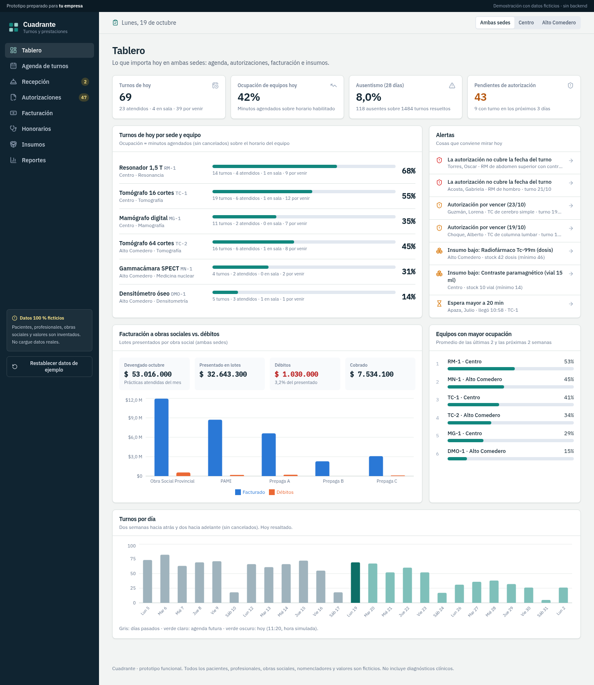

### 2. Agenda de turnos
Grilla diaria o semanal: **columnas = equipos, filas = franjas de 15 o 30 minutos**, con turnos coloreados por estado (asignado, confirmado, en sala, atendido, ausente, cancelado). Se puede **crear turno** (paciente ficticio, práctica, obra social, equipo, fecha y hora) con **detección de superposición** (del equipo y del paciente), horarios fuera de agenda, **preparación requerida** (ayuno, contraste) y aviso de autorización; **mover** y **cancelar** con motivo; y un **recordatorio por WhatsApp prearmado** (enlace `wa.me` con el mensaje; el prototipo no envía nada).

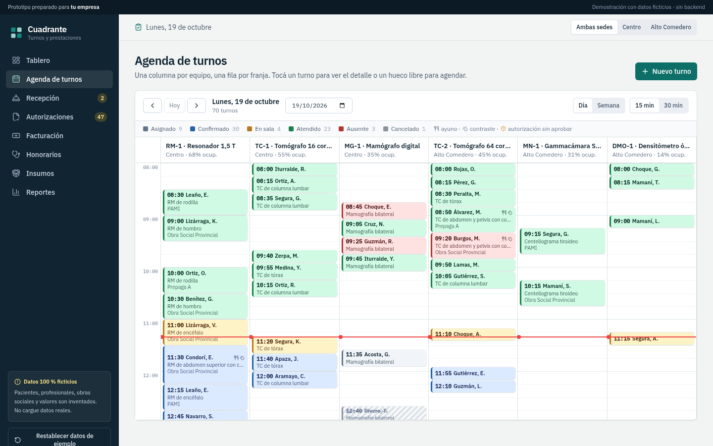

| Nuevo turno con validaciones | Detalle y recordatorio por WhatsApp |
| --- | --- |
| 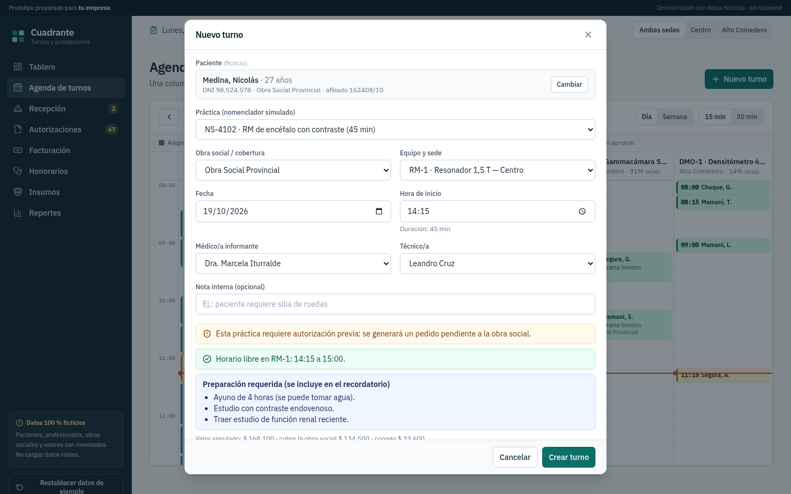 | 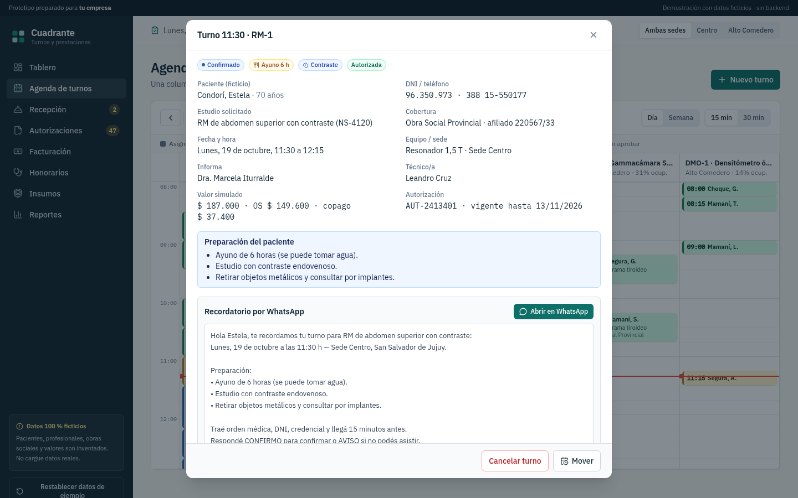 |

### 3. Recepción / sala de espera
Cola del día en **orden de llegada**: check-in, tiempo de espera, **checklist de requisitos** (orden médica, autorización, DNI, credencial y preparación; solo los que corresponden a esa cobertura y práctica) y pasaje a "en sala" y "atendido". El pase a sala se habilita recién con los requisitos completos, y una autorización pendiente o vencida no se puede tildar.

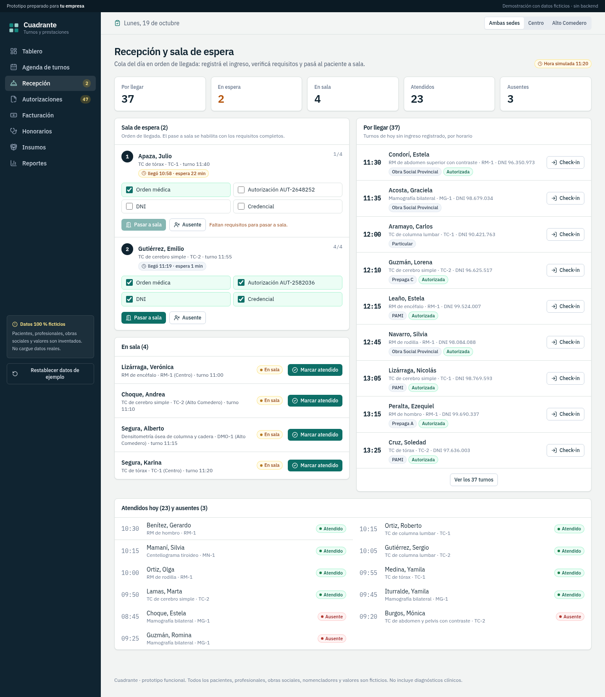

### 4. Autorizaciones
Bandeja de pedidos a obras sociales (pendiente, autorizada, rechazada, vencida) con número, vigencia y acciones (autorizar, rechazar con motivo, editar vigencia, volver a pedir, nuevo pedido). Filtros por obra social, búsqueda y alcance. La condición "vencida" se calcula por la vigencia.

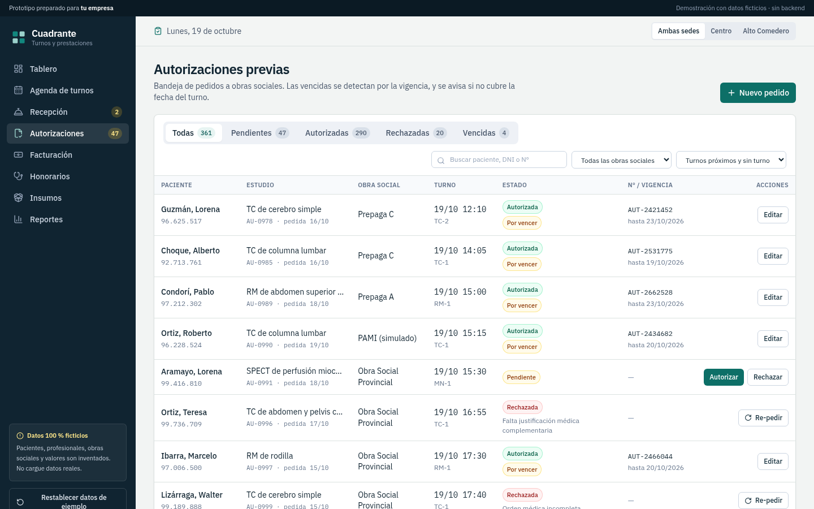

### 5. Facturación a obras sociales
Por obra social y período: prácticas realizadas valorizadas con el **nomenclador simulado** y el **convenio** (factor y porcentaje de cobertura, copago del afiliado), **generación de lote**, resumen **imprimible** y **CSV**, registro de **débitos/rechazos con motivo** (con seguimiento de estado) y **conciliación de cobros** (presentado − débitos − cobrado = saldo). Incluye una pestaña con los convenios y el nomenclador.

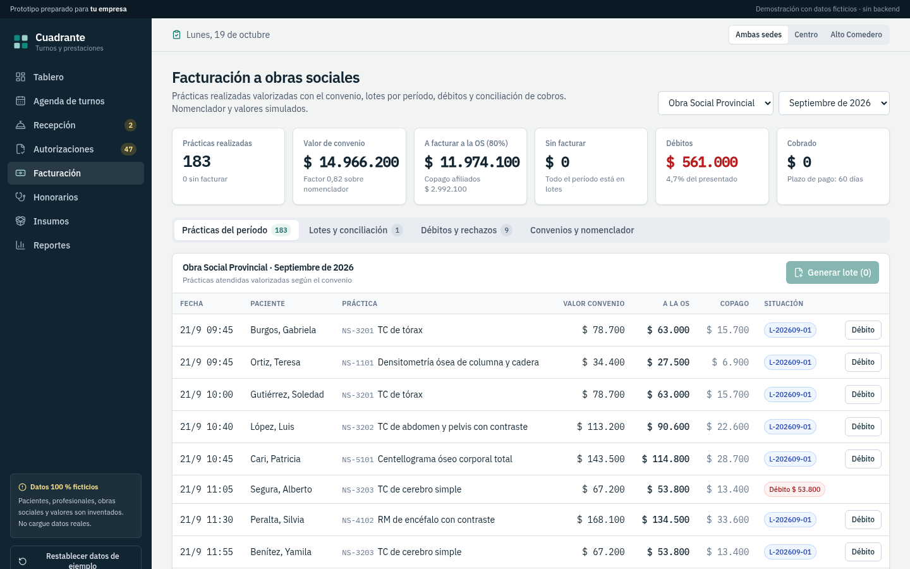

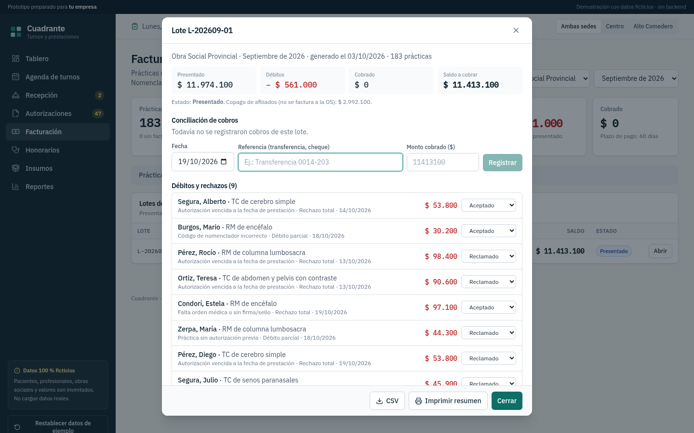

### 6. Honorarios
Liquidación mensual por profesional (médicos informantes y técnicos) con **esquema de pago configurable** (porcentaje del valor liquidable o monto por práctica). La base descuenta los débitos imputados. Detalle imprimible y CSV.

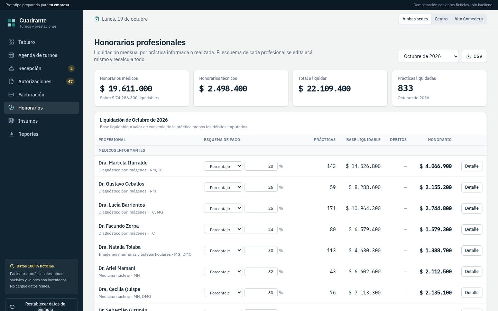

### 7. Insumos
Stock por sede **calculado** a partir de los ingresos y del consumo estimado de cada estudio atendido (contraste, radiofármaco, placas, kits, etc.), cobertura en días, proyección según la agenda de los próximos 14 días, alerta y cantidad sugerida de reposición, y carga de ingresos.

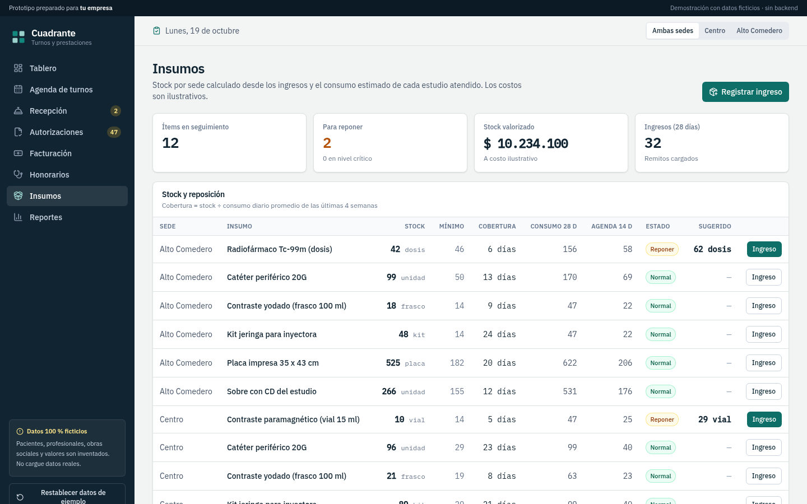

### 8. Reportes
Producción por **equipo, sede, obra social y profesional**, en cantidad o valor, con gráfico, ausentismo, ocupación y **exportación a CSV**.

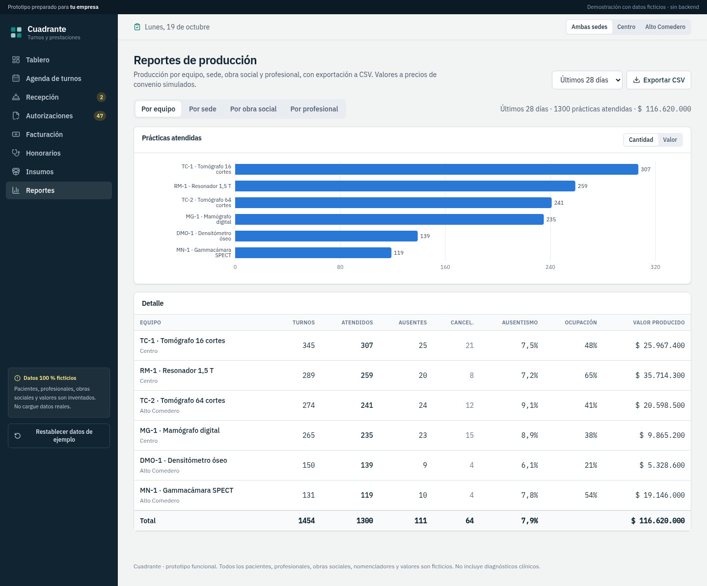

### En el celular
Responsive: menú lateral colapsable, tablero y recepción apilados, agenda con desplazamiento horizontal y columna de horas fija.

| Tablero | Recepción | Agenda |
| --- | --- | --- |
| 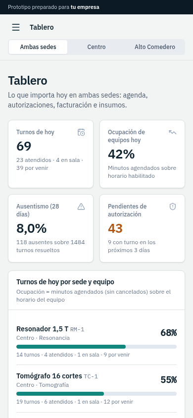 | 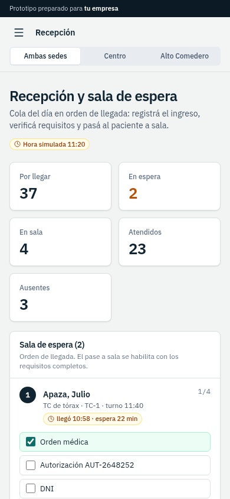 | 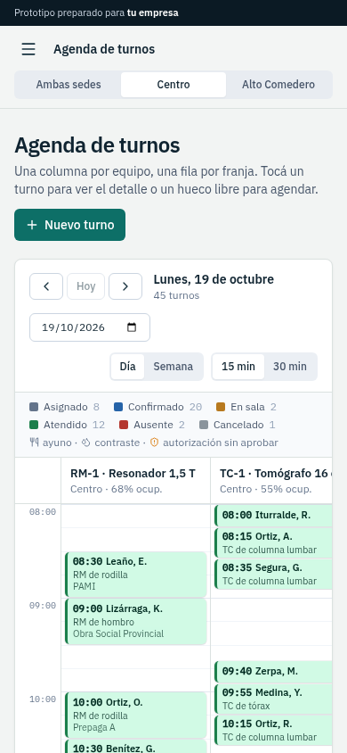 |

## Qué es simulado

- **Datos**: 2 sedes, 6 equipos, 15 profesionales, 240 pacientes y ~2.000 turnos (últimas 4 semanas y próximas 2) generados con un generador pseudoaleatorio fijo en `src/lib/seed.ts`. Se eligió un volumen mayor al de una muestra chica para que la ocupación de los equipos sea realista (entre 15 y 70 % según el equipo).
- **Obras sociales**: "Obra Social Provincial", "PAMI (simulado)", "Prepaga A/B/C" y "Particular". Ninguna es una marca real.
- **Nomenclador y valores**: inventados (`NS-xxxx`), con factor y cobertura por convenio. No corresponden a ningún nomenclador oficial.
- **Integraciones**: no hay conexión con obras sociales, portal de turnos ni WhatsApp. El recordatorio solo arma el enlace `wa.me`; los teléfonos son ficticios.
- **Autorizaciones, lotes y cobros**: se gestionan a mano dentro del prototipo; no se envía nada a nadie.
- **Sin backend ni usuarios**: no hay login, roles ni auditoría. La persistencia es `localStorage`.

## Qué le preguntaría al cliente

1. **¿Cómo se integra con su portal de turnos actual?** ¿Es un producto de terceros con API o exportación? ¿Los pacientes sacan turno solos o siempre pasa por recepción? ¿Quién es hoy la "fuente de verdad" de la agenda: el portal, una planilla o el sistema de la modalidad?
2. **¿Cómo gestionan hoy las autorizaciones previas?** ¿Por teléfono, por el portal de cada obra social o por correo? ¿Cuántos turnos pierden o reprograman por autorizaciones que no llegan a tiempo o que vencen antes del estudio?
3. **¿Cómo arman y presentan la facturación y qué hacen con los débitos?** ¿Qué formato pide cada obra social, cada cuánto presentan y quién concilia los cobros? ¿Qué porcentaje de débitos tienen y cuáles son los motivos más comunes?
4. **¿Cómo liquidan honorarios a radiólogos y técnicos?** ¿Por práctica, por porcentaje o mixto, con guardias o módulos? ¿Descuentan débitos? ¿Cuánto tarda hoy el cierre mensual?
5. **¿Cómo controlan insumos y quién necesita ver cada cosa?** ¿Llevan el stock de contraste, radiofármacos y placas en planilla o en algún sistema? Y a nivel de usuarios: ¿qué ve recepción, qué ve facturación, qué ve la dirección, y qué reportes piden hoy a mano?

## Estructura

```
src/
  config.ts            producto y "preparado para"
  types.ts             modelo de datos
  store.tsx            estado + persistencia en localStorage + acciones
  lib/
    catalogo.ts        sedes, equipos, obras sociales, convenios, nomenclador, insumos
    seed.ts            generador de datos ficticios (relativos a hoy)
    calc.ts            ocupación, superposiciones, valores, autorizaciones, lotes, stock
    dates.ts, format.ts, csv.ts, index.ts
  components/          UI base y modales de turno
  pages/               una por pantalla
scripts/capturas.mjs   regenera docs/capturas (Playwright)
```

Stack: Vite, React 18, TypeScript, Tailwind CSS 3, Recharts, Lucide.

## Regenerar las capturas

```bash
npm run build && npx vite preview --port 4105 &
node scripts/capturas.mjs        # usa playwright-core del repo de herramientas local
```

## Limitaciones conocidas

- Los datos se regeneran cada día (para mantenerse relativos a la fecha), por lo que los cambios hechos un día no se conservan al día siguiente.
- La agenda no arrastra y suelta: mover un turno se hace desde el detalle.
- La liquidación de honorarios y la conciliación son simplificadas (sin retenciones, impuestos ni notas de crédito).
- Pensado para escritorio y celular; no se probó en tablets ni en navegadores antiguos.
